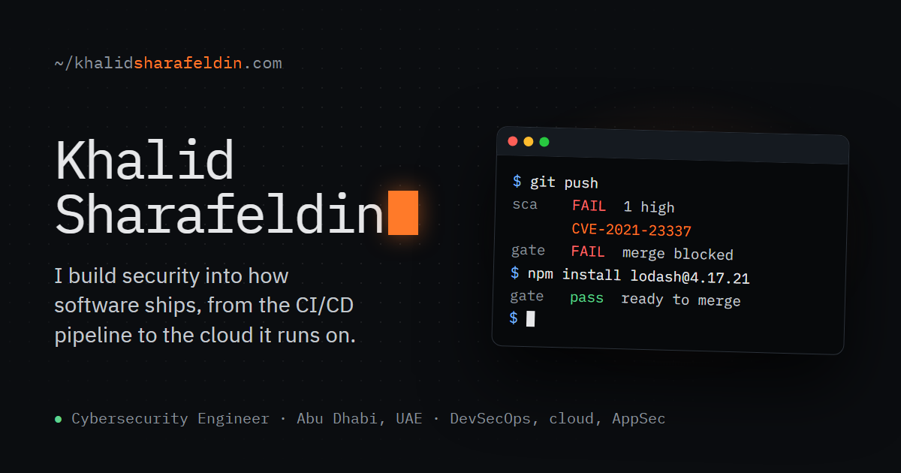

  
  
  

I'm a cybersecurity engineer at Tabby in Abu Dhabi. I own the security scanning in the CI/CD pipeline, configure cloud security policies, and run penetration tests of web and mobile apps. I started in offensive security, and I'm studying for OSCP.

### What I work on

- **DevSecOps.** I run SAST and SCA in CI/CD and tune them so developers see real findings and fewer false positives.
- **Cloud security.** I configure cloud security policies and automated case workflows.
- **Application security.** I test web and mobile apps every quarter and track findings to remediation.

### Certifications

| Certification | Issuer | Status |
| :-- | :-- | :-- |
| OSCP, OffSec Certified Professional | OffSec | In progress |
| eCIR, Certified Incident Responder | INE | In progress |
| eMAPT, Mobile Application Penetration Tester | INE | 2026 |
| eWPTX, Web Application Penetration Tester eXtreme | INE | 2024 |
| eCPPT, Certified Professional Penetration Tester | INE | 2024 |
| eWPT, Web Application Penetration Tester | INE | 2022 |
